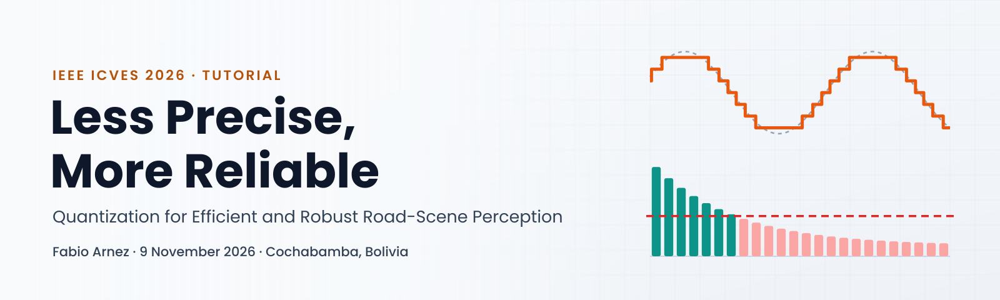
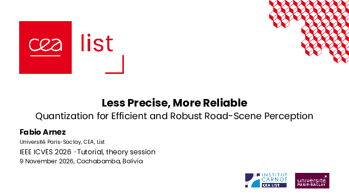
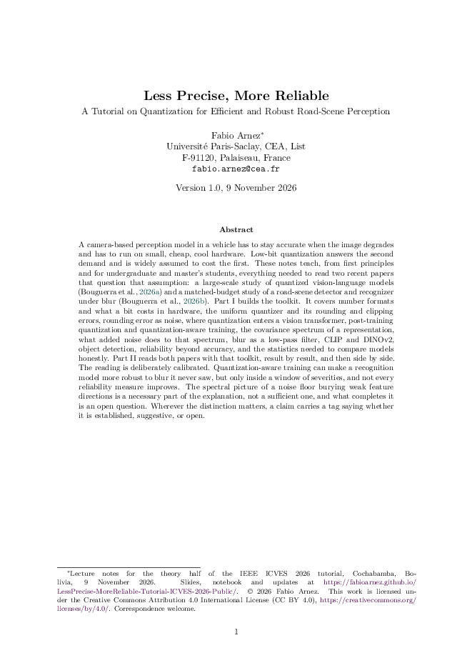
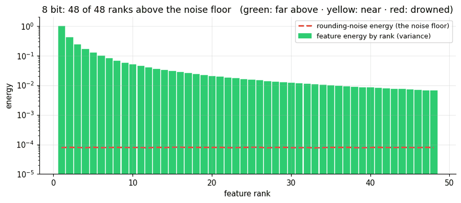
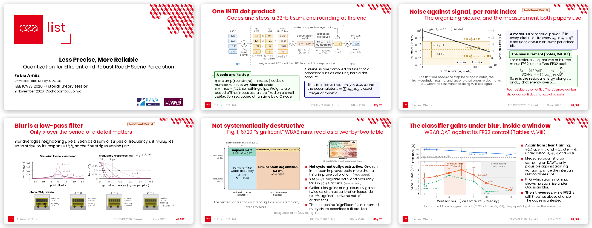
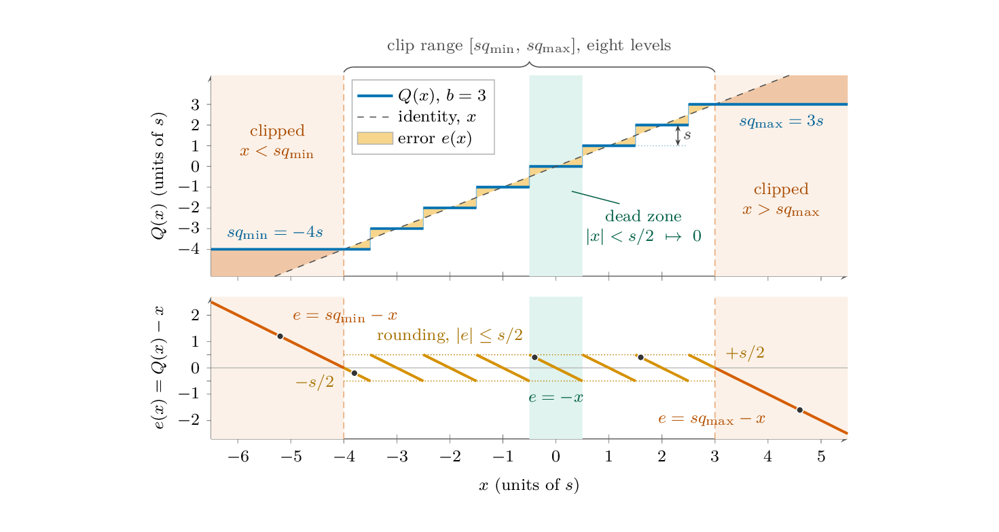
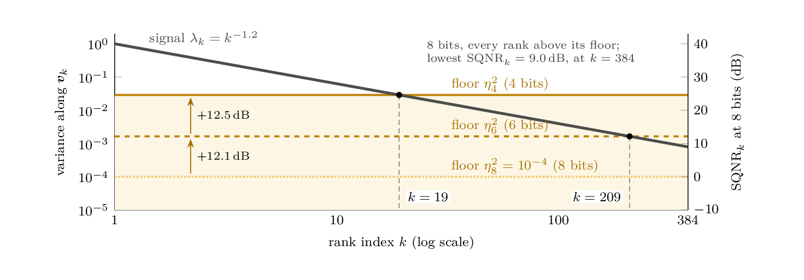
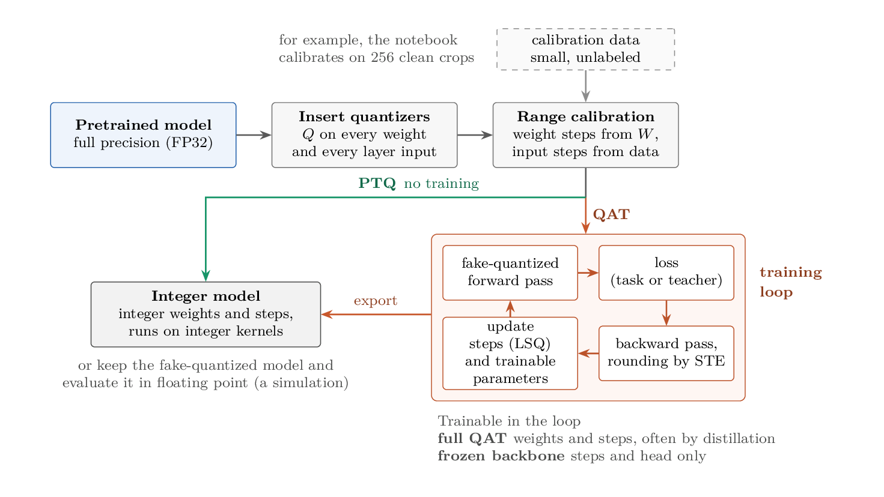
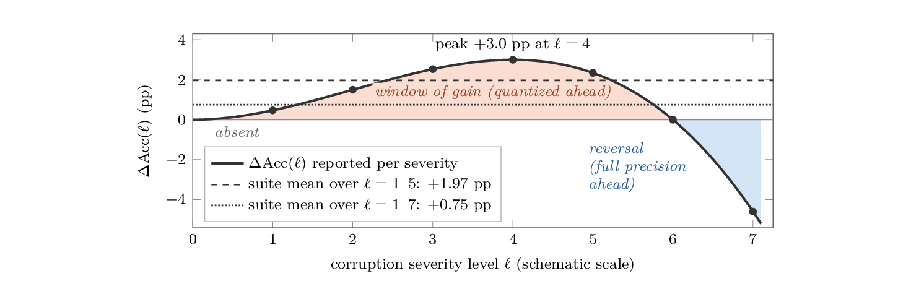

<p align="center">
  <a href="https://fabioarnez.github.io/LessPrecise-MoreReliable-Tutorial-ICVES-2026-Public/">
    <picture>
      <source media="(prefers-color-scheme: dark)" srcset="assets/img/banner-dark.png">
      
    </picture>
  </a>
</p>

<p align="center">
  <a href="https://fabioarnez.github.io/LessPrecise-MoreReliable-Tutorial-ICVES-2026-Public/"></a>
  <a href="slides/LessPrecise-MoreReliable_ICVES2026_slides.pdf"></a>
  <a href="lecture-notes/LessPrecise-MoreReliable_ICVES2026_lecture-notes.pdf"></a>
  <a href="https://colab.research.google.com/github/FabioArnez/LessPrecise-MoreReliable-Tutorial-ICVES-2026-Public/blob/main/notebook/Quantization_Corruption_Robustness_Tutorial.ipynb"></a>
  <a href="#license"></a>
</p>

# Less Precise, More Reliable

**Quantization for Efficient and Robust Road-Scene Perception.** A three-hour tutorial at the [IEEE International Conference on Vehicular Electronics and Safety (ICVES 2026)](https://ieee-itss.org/conf/icves), 9 November 2026, Cochabamba, Bolivia.

Presented by **Fabio Arnez** (Université Paris-Saclay, CEA, List). The tutorial was built in collaboration with **Aymen Bouguerra**, PhD student at Université Paris-Saclay, CEA, List.

This repository gathers everything in one place. The tutorial page is at **[fabioarnez.github.io/LessPrecise-MoreReliable-Tutorial-ICVES-2026-Public](https://fabioarnez.github.io/LessPrecise-MoreReliable-Tutorial-ICVES-2026-Public/)**.

## Materials

| | |
|:---:|---|
| <a href="slides/LessPrecise-MoreReliable_ICVES2026_slides.pdf"></a> | **[Slides (PDF)](slides/LessPrecise-MoreReliable_ICVES2026_slides.pdf)**<br>The deck of the theory session, about 90 slides in two parts, without the backup slides. Every number taken from the papers carries its locator. |
| <a href="lecture-notes/LessPrecise-MoreReliable_ICVES2026_lecture-notes.pdf"></a> | **[Lecture notes (PDF)](lecture-notes/LessPrecise-MoreReliable_ICVES2026_lecture-notes.pdf)**<br>The written companion, about 180 pages. Part I builds the toolkit from first principles, Part II reads both studies result by result, with exercises and worked examples. |
| <a href="https://colab.research.google.com/github/FabioArnez/LessPrecise-MoreReliable-Tutorial-ICVES-2026-Public/blob/main/notebook/Quantization_Corruption_Robustness_Tutorial.ipynb"></a> | **[Hands-on notebook](notebook/Quantization_Corruption_Robustness_Tutorial.ipynb)** · [Open in Colab](https://colab.research.google.com/github/FabioArnez/LessPrecise-MoreReliable-Tutorial-ICVES-2026-Public/blob/main/notebook/Quantization_Corruption_Robustness_Tutorial.ipynb) · [nbviewer](https://nbviewer.org/github/FabioArnez/LessPrecise-MoreReliable-Tutorial-ICVES-2026-Public/blob/main/notebook/Quantization_Corruption_Robustness_Tutorial.ipynb)<br>Code and animations for the second half. Parts 1 to 4 run on a laptop CPU in seconds. Part 5 needs a GPU and takes about 10 to 12 minutes on a Colab T4. |

## What the tutorial covers

<p align="center"></p>

A camera-based perception model in a vehicle has to stay accurate when the image degrades, and it has to run on small, cheap, low-power hardware. Low-bit quantization answers the second demand and is widely assumed to cost the first. The tutorial teaches, from first principles, what you need to read two recent studies that question that assumption.

The first half builds the toolkit. It covers number formats and the integer kernel, the uniform quantizer and its errors, rounding error as noise, post-training quantization (PTQ) and quantization-aware training (QAT), the spectrum of a representation, blur as a low-pass filter, perception models, and the statistics needed for fair comparisons. It then reads a large-scale study of quantized vision-language models and a matched-budget study of road-scene perception under blur. The second half is hands-on, in a notebook that builds the same idea with code and animations and then tests it on a DINOv2 vision transformer with road-object crops from DAWN.

> **The reading is calibrated.** Under moderate blur, an 8-bit classifier trained through its quantizer was more accurate than its full-precision counterpart, but only inside a window of severities, and not every reliability measure improves. Quantization noise and blur act on the same weak feature directions, yet noise of the same size does not reproduce the gain, so what in the quantizer does the work is still an open question.

### Program

| Theory session, about 1.5 h | Hands-on session, about 1.5 h |
|---|---|
| Opening, perception in the vehicle and its two demands | **Part 0.** Setup and the talk clips |
| **Part I, Foundations.** Numbers and the integer kernel, the uniform quantizer, rounding error as noise, PTQ and QAT in a network, features and their spectrum, images and blur, perception models, reliability and fair comparisons | **Parts 1 and 2.** What quantization does to a model, one step at a time, and the same noise on a strong and a weak feature |
| **Part II, The papers.** The question, the VLM study, the road-scene study and its classifier, what it means for automotive perception | **Parts 3 and 4.** A spectrum of features against one flat noise floor, then images with a general and a specialized cue |
| Questions, then a live demo | **Part 5.** DINOv2 ViT-S/14 on DAWN crops, W8A8 PTQ and QAT under Gaussian blur (GPU) |

### Key ideas, from the lecture notes

| | |
|:---:|:---:|
|  |  |
| The uniform quantizer. Rounding error stays within half a step inside the clip range, and clipping error grows outside it. | A flat rounding-noise floor over a power-law feature spectrum. Each bit removed raises the floor by about 6 dB. |
|  |  |
| PTQ calibrates the quantizer ranges after training. QAT trains with the quantizer in the forward pass. | A severity window, as a schematic. A gain under moderate corruption can reverse at heavy corruption. |

## Run the notebook

**In Google Colab.** Open the notebook with the Colab badge above. For Part 5, choose *Runtime, Change runtime type, T4 GPU*. Run the cells in order. Part 5 downloads the DAWN crops and the DINOv2 weights from Hugging Face.

**Locally.** Python 3.12 or 3.13 is recommended (Colab runs 3.13).

```bash
git clone https://github.com/FabioArnez/LessPrecise-MoreReliable-Tutorial-ICVES-2026-Public.git
cd LessPrecise-MoreReliable-Tutorial-ICVES-2026-Public/notebook
python3 -m venv .venv
source .venv/bin/activate
python -m pip install -r requirements.txt
jupyter lab Quantization_Corruption_Robustness_Tutorial.ipynb
```

Part 5 runs on a CUDA GPU, then on Apple's GPU (MPS), then on the CPU, where it takes hours. The six talk clips of Parts 1 to 3 download in Part 0 from a Google Drive link. If the download fails, the notebook prints a note and continues without them. Details are in [notebook/README.md](notebook/README.md).

## The papers

The tutorial reads two studies by the same group.

- **The VLM study.** Bouguerra, A., Montoya, D., Gomez-Villa, A., Mraidha, C., & Arnez, F. (2026). Less precise can be more reliable: A systematic evaluation of quantization's impact on VLMs beyond accuracy. In *Proceedings of the 43rd International Conference on Machine Learning* (Vol. 306). PMLR. [PMLR](https://proceedings.mlr.press/v306/bouguerra26a.html) · [arXiv](https://arxiv.org/abs/2509.21173) · [Code](https://github.com/CEA-LIST/less-precise-more-reliable-vlms) · [Project page](https://aymenbouguerra.github.io/Less-Precise-Can-Be-More-Reliable/)
- **The road-scene study.** Bouguerra, A., Radermacher, A., Arnez, F., & Mraidha, C. (2026). Quantization and corruption robustness in deployed road-scene perception. In *Proceedings of the 2026 IEEE International Conference on Vehicular Electronics and Safety (ICVES)*. IEEE. To appear. [Project page](https://aymenbouguerra.github.io/Quantization-and-Corruption-Robustness-in-Deployed-Road-Scene-Perception/) · [Code](https://github.com/CEA-LIST/Quantization-and-Corruption-Robustness-in-Deployed-Road-Scene-Perception)

## Repository layout

```
├── index.html, assets/   the tutorial page (GitHub Pages) and the images of this README
├── slides/               slides PDF, without the backup slides
├── lecture-notes/        lecture notes PDF
├── notebook/             hands-on notebook and its requirements
├── CITATION.cff
└── LICENSE               MIT, for the code
```

## Citation

If you use the material, please cite the tutorial, and the two studies for their results. GitHub's *Cite this repository* button reads [CITATION.cff](CITATION.cff).

```bibtex
@misc{arnez2026lessprecise,
  author       = {Arnez, Fabio},
  title        = {Less Precise, More Reliable: Quantization for Efficient
                  and Robust Road-Scene Perception},
  howpublished = {Tutorial at the IEEE International Conference on
                  Vehicular Electronics and Safety (ICVES)},
  address      = {Cochabamba, Bolivia},
  month        = nov,
  year         = {2026},
  url          = {https://fabioarnez.github.io/LessPrecise-MoreReliable-Tutorial-ICVES-2026-Public/}
}
```

## License

- **Slides and lecture notes** (the PDFs in `slides/` and `lecture-notes/`). © 2026 Fabio Arnez, licensed under [CC BY 4.0](https://creativecommons.org/licenses/by/4.0/). The CEA logos and slide template, and the figures reproduced from the papers, are excluded and keep their own terms. See the `LICENSE.md` file in each folder.
- **Code** (the notebook and the tutorial page). [MIT License](LICENSE), © 2026 Aymen Bouguerra and Fabio Arnez.
- **Data and models** used by the notebook keep their licenses. The DAWN images (Kenk & Hassaballah, 2020) are CC BY-NC 3.0, for non-commercial use only, and the DINOv2 weights (Oquab et al., 2024) are Apache 2.0.

## Acknowledgments

Aymen Bouguerra wrote the hands-on notebook, which Fabio Arnez adapted. The work comes from Université Paris-Saclay, CEA, List. The notebook uses the DAWN dataset through the Hugging Face copy `Maxim37/dawn-dataset`, and DINOv2 through `timm`.

Questions and corrections are welcome by [e-mail](mailto:fabio.arnez@cea.fr) or as GitHub issues.
